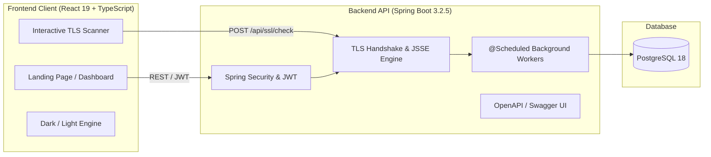

# 🛡️ SSLGuard — Enterprise SSL/TLS Certificate Intelligence Platform

[]()
[]()
[]()
[]()
[]()
[]()
[]()

> **SSLGuard** is a modern, enterprise-grade cybersecurity platform that prevents unexpected domain downtime by continuously evaluating X.509 certificate trust chains, analyzing TLS protocols and cipher suites, and automating proactive expiration defense.

---

## 🌟 Key Features

* **⚡ Low-Latency Direct TLS Handshake Engine**: Direct socket connections probe port 443 in `<200ms`, verifying leaf certificates, intermediate authorities, and root anchors against RFC 5280 standards.
* **🛡️ Security Grade Scoring (A+ to F)**: Automated cryptographic evaluation of protocol strengths (TLS 1.2 / TLS 1.3), cipher negotiation, and vulnerability detection (e.g., POODLE, deprecated protocols).
* **🔔 Multi-Tier Expiration Defense**: Automated background worker schedulers flag renewals across prioritized windows:
  * 🔴 **Critical Tier**: $\le 7$ days remaining
  * 🟡 **Warning Window**: $\le 30$ days remaining
  * 🟢 **Healthy / Compliant**: $> 30$ days remaining
  * ⚫ **Expired / Past Due**: Historical logs and alerts
* **🌐 Fleet Domain Inventory**: Centralized management dashboard with real-time health scores, manual re-verification triggers, and CSV report export.
* **🔐 Stateless JWT Authentication**: Spring Security 6 pipeline using HS512 signed JSON Web Tokens and BCrypt password encryption.
* **📊 Modern Enterprise UI/UX**: Built with React 19, Tailwind CSS v4, Framer Motion, and Recharts, featuring dark/light theme switching, accessible keyboard navigation (`:focus-visible`), and WCAG reduced-motion support.

---

## 🏗️ Architecture Overview



---

## 🛠️ Tech Stack

### Frontend
* **Core:** React 19, TypeScript, Vite 8
* **Styling & Design System:** Tailwind CSS v4, Glassmorphism, Semantic Tokens
* **Animations:** Framer Motion (GPU accelerated)
* **Data Fetching & State:** TanStack React Query v5, Zustand
* **Visualizations:** Recharts (Expiry Timeline, Security Grade Distribution)
* **Icons & Notifications:** Lucide React, React Hot Toast

### Backend
* **Language & Framework:** Java 17+ (Java 26 compatible), Spring Boot 3.2.5
* **Security:** Spring Security 6, JJWT (HS512), BCrypt
* **Data Persistence:** Spring Data JPA, Hibernate 6.4, HikariCP
* **Networking & Crypto:** Java JSSE, SSLSocket, X509Certificate, RFC 5280
* **API Documentation:** Springdoc OpenAPI 2.5 (Swagger UI)
* **Database:** PostgreSQL 18

---

## 🚀 Getting Started

### Prerequisites
* **Java**: JDK 17 or higher (`java -version`)
* **Node.js**: v18 or higher (`node -v`)
* **PostgreSQL**: PostgreSQL 14+ running on port `5432` with a database named `sslchecker`
* **Maven**: 3.8+ (or use included wrapper)

---

### 1. Database Setup

Create the PostgreSQL database:
```sql
CREATE DATABASE sslchecker;
```

---

### 2. Environment Configuration

Copy the example environment file and configure your credentials:
```bash
cp .env.example .env
```

| Variable | Description | Default |
| :--- | :--- | :--- |
| `SPRING_DATASOURCE_URL` | PostgreSQL JDBC connection URL | `jdbc:postgresql://localhost:5432/sslchecker` |
| `SPRING_DATASOURCE_USERNAME` | Database username | `postgres` |
| `SPRING_DATASOURCE_PASSWORD` | Database password | `postgres` |
| `JWT_SECRET` | 256-bit+ secret key for HS512 JWT | *(Set in production)* |
| `SPRING_MAIL_USERNAME` | SMTP alert email address | `your-email@gmail.com` |
| `SPRING_MAIL_PASSWORD` | SMTP application password | `your-app-password` |

---

### 3. Backend Setup

```bash
cd ssl-checker-backend
mvn clean install
mvn spring-boot:run
```
* Backend server starts on **`http://localhost:8080`**
* Interactive Swagger API documentation: **`http://localhost:8080/swagger-ui.html`**

---

### 4. Frontend Setup

```bash
cd ssl-checker-frontend
npm install
npm run dev
```
* Frontend client starts on **`http://localhost:5173`**
* Production build: `npm run build`

---

## 📡 Core API Endpoints

| Method | Endpoint | Description | Auth Required |
| :--- | :--- | :--- | :--- |
| `POST` | `/api/ssl/check` | Live socket TLS handshake & chain audit | No |
| `POST` | `/api/auth/register` | Register new user account | No |
| `POST` | `/api/auth/login` | Authenticate user & receive JWT token | No |
| `GET` | `/api/dashboard/stats` | Fleet health metrics & distribution | Yes (Bearer) |
| `GET` | `/api/domains` | Retrieve user monitored domains list | Yes (Bearer) |
| `POST` | `/api/domains` | Add domain with automated initial check | Yes (Bearer) |
| `POST` | `/api/domains/{id}/check` | Trigger on-demand manual verification | Yes (Bearer) |
| `DELETE` | `/api/domains/{id}` | Remove domain from monitoring | Yes (Bearer) |

---

## 🔒 Security & Privacy

* **Zero Hardcoded Secrets**: All sensitive values (passwords, JWT secrets, mail credentials) are dynamically configured via environment variables and excluded via `.gitignore`.
* **Stateless Tokens**: JWTs use HS512 cryptographic signatures with automatic expiration.
* **Socket Safety**: Handshake sockets utilize strict 10-second connection timeouts to protect against Slowloris-style denial-of-service hanging.

---

## 📄 License

This project is licensed under the [MIT License](LICENSE).
